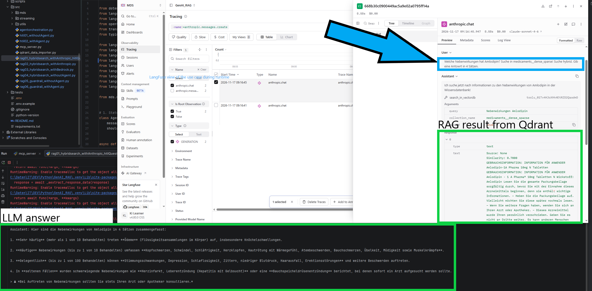
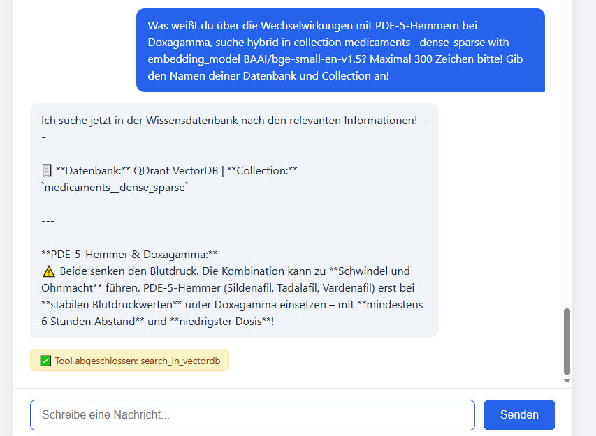

Repository with GenAI apps targetting single are aggregated features of modern GenAI such as:

- LLM: Anthropic & AWS Bedrock 

- Agent orchestration

- RAG 

  - realized with LangGraph and MCP

  - hybrid search ( semantic and keyword ) against a vector DB  with reranking
  
  - non-hybrid search against a vector DB

- Indexing: Multiple embedding models ( BAAI/HARRIER/QWEN ) 

- Human interaction: HITL

- Security: Guardrails

- Observability: MLflow, LangFuse   

***PREREQUISITES***
!!! Configure your .env file !!! => Use .env.example as template!

=> ANTHROPIC_API_KEY, AWS_PROFILE ( if AWS Bedrock and Guardrails is used ) , LANGFUSE_SECRET_KEY and LANGFUSE_PUBLIC_KEY 

***USE CASES***

**rag01_hybridsearch_withAnthropic_hitlQuestionLoop_langFuse**

<figure>
  
  <figcaption>LangFuse view of the use case rag01 during runtime</figcaption>
</figure>

In this scenario a user asks for the adverse effects of medicament Amlodipin. An LLM answers based on data in the Qdrant vector database. The user can continue to ask further questions.

Technically, an LLM decides what is to be done to answer the prompt question 

Therefore a LangGraph graph is created. It contains the famous agent loop of reasoning and acting.

Acting means an MCP client : server communication, where the server calls Qdrant.

The Qdrant vector database is configured with the MEDICAMENTS__DENSE_SPARSE data ( use  /utils/qdrant_data_importer.py ).

How can it be tested:

*1. Just start the Qdrant vector database* 

docker run --name ai-agent-qdrant -p 6333:6333 -p 6334:6334 qdrant/qdrant

IMPORTANT: Add the MEDICAMENTS documents from data/input/medicaments to Qdrant :

cd src

src> ..\.venv\Scripts\python.exe -m utils.qdrantDataImporter

UI: http://localhost:6333/dashboard#/collections 

Collections 'medicaments' and 'medicaments__dense_sparse' will be created!

*2. Start LangFuse*

(   install:  git clone https://github.com/langfuse/langfuse.git &   dock-compose up -d )

UI: http://localhost:3000/

*3.[Optional] Start MLflow server for observability/tracing ( LLM,TOOl,CHAIN,RETRIEVER )*

./mlflow.exe server --port 5000

UI: http://localhost:5000/

*4. Start MCP server*

cd src
src> ..\.venv\Scripts\python.exe -m mcp_server

*5. Execute the query and interact with the agent*

cd src

Attention: activate the prompts you want to test!

src> ..\.venv\Scripts\python.exe -m rag01hybridsearch_withAnthropic_hitlQuestionLoop.py

Type-in questions like: 

Welche Nebenwirkung hat Doxagamma? Nutze Datenbank medicaments__dense_sparse! Nenne deine Quellen!

Welche Nebenwirkung hat Amlodipin? Nutze Datenbank medicaments__dense_sparse! Nenne deine Quellen!
                        
quit

**-------------------------------------------------------------------------------------------------------------------**

**rag01_streaming_frontend.py ( React frontend, connected to 'RAG backend' allowing for chats )**

<figure>
  
  <figcaption>React frontend with streaming response display</figcaption>
</figure>

Start ( LangFuse, start MLflow,) start the mcp server:

see above

Start the backend :

cd src

uvicorn.exe rag01_fastapi_frontend:app --reload --port 8000

Start the frontend:

npm create vite@latest frontend -- --template react 

npm run dev

**-------------------------------------------------------------------------------------------------------------------**

**rag02_hybridsearch_withAnthropic & rag04_hybridsearch_withBedrock ( deprecated, prototype of rag01 )**

In this scenario an LLM decides what is to be done to answer the prompt question 

=> therefore a LangGraph graph is created. It contains the famous agent loop of reasoning and acting.

Acting means an MCP client : server communication, where the server calls Qdrant.

The Qdrant vector database is configured with MEDICAMENTS data ( use  /utils/qdrantDataImporter.py ).

How can it be tested:

*1. Just start the Qdrant vector database* 

docker run --name ai-agent-qdrant -p 6333:6333 -p 6334:6334 qdrant/qdrant

Add the MEDICAMENTS document from data/input/medicemtns to Qdrant  ( embeddings! ):

cd src
src> ..\.venv\Scripts\python.exe -m utils.qdrantDataImporter

UI: http://localhost:6333/dashboard#/collections 

Collections 'medicaments' and 'medicaments__dense_sparse' will be created!

*2. Start MLflow server for observability/tracing ( LLM,TOOl,CHAIN,RETRIEVER )*

./mlflow.exe server --port 5000

UI: http://localhost:5000/

*3. Start MCP server*

cd src
src> ..\.venv\Scripts\python.exe -m mcp_server

*4. Execute the query*
cd src
Attention: activate the prompts you want to test!

src> ..\.venv\Scripts\python.exe -m rag02_hybridsearch_withAnthropic.py

src> ..\.venv\Scripts\python.exe -m rag03_hybridsearch_withBedrock.py

Logs of successful runs are under ./data/results/logs.

**-------------------------------------------------------------------------------------------------------------------**

**rag04_hybridsearch_withoutAgent (  utility to just test retrieval performance, no MCP, no LLM )**

The Qdrant vector database is configured with MEDICAMENTS data ( use  /utils/qdrantDataImporter.py ).

Without using LLM, MCP and Langgraph, the database can be directly accessed - 

either via a normal search or via a hybrid search ( with embedding types Harrier, Baai  ). 

Hybrid search: 1st step: a sparse and a dense search are being executed. In the 2nd step both results are being reranked using a Hugging Face model.

Screenshots of the results under and /data/results/normalSearch_notPrecise.png /data/results/hybridSearch_Precise.png .

Attention: database and query must have the same embedding type. Use the qdrantDataImport with the same embedding type as the one used for searching!

How can it be tested:

*1. Just start the Qdrant vector database* 

docker run --name ai-agent-qdrant -p 6333:6333 -p 6334:6334 qdrant/qdrant

Add MEDICAMENTS documents from data/input/medicament to Qdrant  ( embeddings! ):

python  qdrantDataImporter

UI: http://localhost:6333/dashboard#/collections 

Collections 'medicaments' and 'medicaments__dense_sparse' will be created!

*2. Execute the query*

python rag_hybridsearch_usecase01.py

**-------------------------------------------------------------------------------------------------------------------**

**rag05_guardrail_withoutAgent & rag06_guardrail_withAgent ( show how to integrate AWS Guardrail )**

The prompt contains inappropriate language  / an email address.

AWS Guardrail is called before the LLM is called ( 06 ).

**-------------------------------------------------------------------------------------------------------------------**

**agentorchestation01 ( agent hierarchy, stronlgy asyncio-based )**

Agent hierarchy: a supervisor agents  coordinates 3 low-level agents. 

Orchestration via asyncio features.

No LangGraph.

No  LLM.

**-------------------------------------------------------------------------------------------------------------------**

**hitl01_withoutAgent ( early prototype )**

LangGraph-based.

No LLM.

**hitl02_withAgent ( early prototype )**

LangGraph and LLM.

Tools contain MCP tools and the delete tool.

A user must confirm, that a file is to be deleted.

